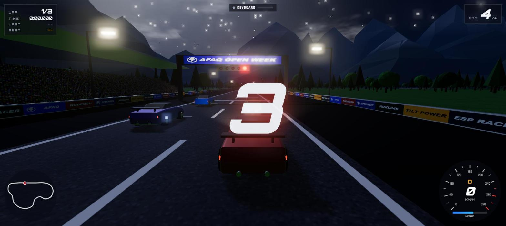
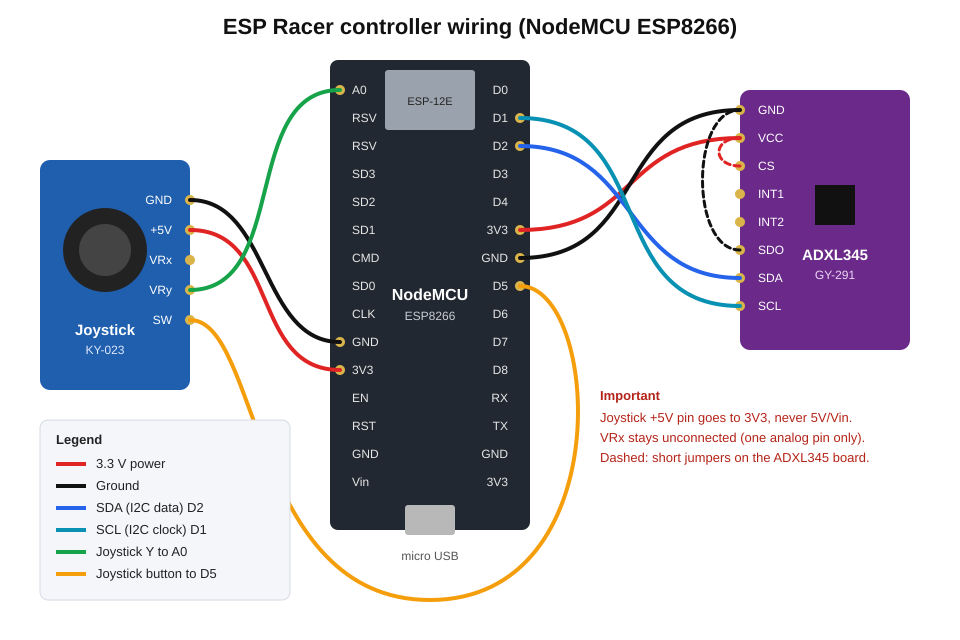
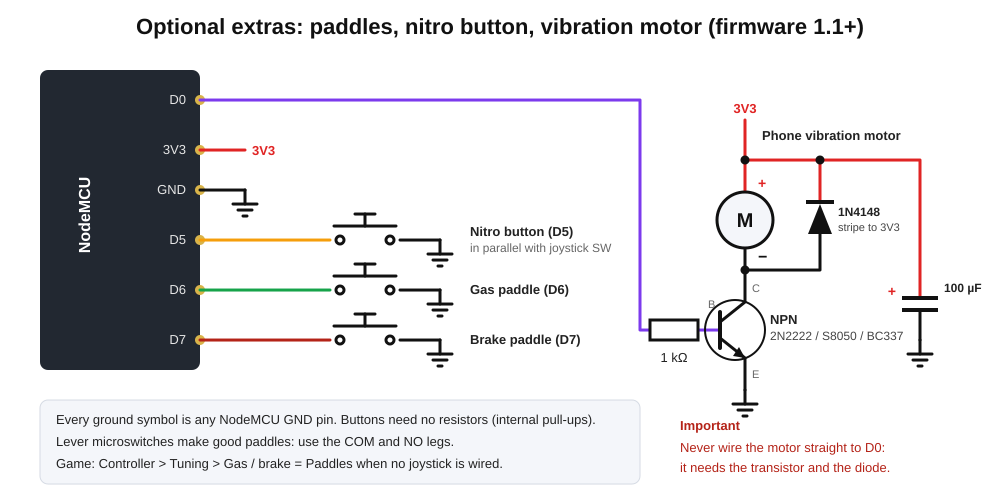

# ESP Racer

**A 3D racing game you drive by tilting a homemade ESP8266 controller.**
Built for **AFAQ Open Week** by the AFAQ Scientific Club.



- Tilt the controller to steer (ADXL345 accelerometer, MPU6050 supported too)
- Joystick: up = gas, down = brake then reverse, hold the button = nitro
- Optional gas/brake paddles, a nitro button and a phone vibration motor for crash and nitro feedback
- Connect over **USB** or **WiFi** (the controller can make its own hotspot)
- Race up to 5 AI drivers or chase lap records, on 3 tracks at day, sunset or night
- Runs in the browser: no game engine, no installs, works offline

Everything is in this repo: firmware, game, wiring diagrams and docs.

---

## Quick start (about 15 minutes)

You need: a **NodeMCU ESP8266**, an **ADXL345** module (GY-291), a **joystick** module (KY-023),
9 jumper wires, a micro USB data cable, and Chrome or Edge on a computer.

### 1. Wire it



| From | To NodeMCU |
|---|---|
| ADXL345 VCC | 3V3 |
| ADXL345 GND | GND |
| ADXL345 SDA | D2 |
| ADXL345 SCL | D1 |
| ADXL345 CS | 3V3 |
| ADXL345 SDO | GND |
| Joystick GND | GND |
| Joystick +5V | **3V3** (not 5V) |
| Joystick VRy | A0 |
| Joystick SW | D5 |
| Joystick VRx | not connected |

Optional extras (firmware 1.1+), each button's other leg goes to GND:



| From | To NodeMCU |
|---|---|
| Gas paddle | D6 |
| Brake paddle | D7 |
| Nitro button | D5 (in parallel with the joystick SW) |
| Vibration motor | D0 through an NPN transistor, **never directly** (circuit in [docs/hardware.md](docs/hardware.md#vibration-motor-optional)) |

Details, assembly tips and the MPU6050 upgrade: [docs/hardware.md](docs/hardware.md).

### 2. Start the game

- **Windows**: double-click `start-game.bat`
- **macOS / Linux**: run `./start-game.sh`

The game opens in your browser at `http://localhost:8080`. Keyboard works right away (arrows + space).

### 3. Install the firmware

In the game: **Controller > Install firmware on the ESP8266**, plug in the NodeMCU, click
**Connect & install**. No Arduino IDE needed. (Prefer PlatformIO or Arduino IDE? See [docs/firmware.md](docs/firmware.md).)

### 4. Connect and calibrate

1. Go back to the game tab: **Controller > Connect USB**, pick the port.
   Keep the stick released while it connects.
2. **Calibrate (guided)**: hold level, press the nitro button; tilt right, press; push the stick up.
   Using paddles instead of the joystick? Set **Gas / brake** to **Paddles** first.
3. Back to the menu, **Race**, **Start**. Go!

Want it wireless? The controller already runs a hotspot: join WiFi `ESP-Racer` (password `racer1234`)
and click **Connect WiFi** (`192.168.4.1`). Or put it on your home WiFi from the game.
See [docs/connecting.md](docs/connecting.md).

---

## Controls

| Action | Controller | Keyboard |
|---|---|---|
| Steer | Tilt left / right | Arrows / A D |
| Gas | Stick up / gas paddle | Up / W |
| Brake, then reverse | Stick down / brake paddle | Down / S |
| Nitro | Hold nitro button | Space / Shift |
| Pause | Double-click nitro button | Esc / P |
| Menus | Stick or paddles to move, tilt to change, nitro to select | Arrows, Enter, Esc, mouse |

## Documentation

| Doc | What's inside |
|---|---|
| [docs/hardware.md](docs/hardware.md) | Parts list, full pinout, wiring diagram, status LED, MPU6050 upgrade |
| [docs/firmware.md](docs/firmware.md) | Installing firmware 3 ways, checking it works, rebuilding |
| [docs/connecting.md](docs/connecting.md) | USB, WiFi hotspot, home WiFi, calibration, serial commands |
| [docs/game.md](docs/game.md) | Running, modes, tracks, settings, code map, making tracks |
| [docs/protocol.md](docs/protocol.md) | The text protocol, for writing your own clients |
| [docs/troubleshooting.md](docs/troubleshooting.md) | Fixes for common problems |

## Repo layout

```
esp-racer-game/
  start-game.bat / start-game.sh   one-click launchers
  game/                            the browser game (Three.js, no build step)
    flash/                         browser firmware installer + prebuilt firmware.bin
  firmware/                        ESP8266 firmware (PlatformIO project + Arduino sketch folder)
    esp-racer-controller/          the sketch: .ino, config.h, sensor, WiFi, settings
  docs/                            documentation and wiring diagram
  tools/                           local web server, firmware build scripts, car model and sound builders
```

## Credits

- Made for AFAQ Open Week. AFAQ mark and Unixel font from the [AFAQ brand kit](https://afaq.club/brand).
- [Three.js](https://threejs.org) r170 (MIT), vendored in `game/vendor/three/`.
- Car model: ["Porsche GT3 RS"](https://sketchfab.com/3d-models/porsche-gt3-rs-e738eae819c34d19a31dd066c45e0f3d)
  by [Black Snow](https://sketchfab.com/BlackSnow02), [CC BY 4.0](http://creativecommons.org/licenses/by/4.0/).
  Simplified for the game (engine and most of the cabin removed, fewer polygons and materials) by `tools/car-model/`.
- Sounds: real recordings from [BigSoundBank](https://bigsoundbank.com) (Joseph Sardin, CC0) and
  [Kenney](https://kenney.nl) (CC0, announcer voices by Jeffrey M. Smith and Giselle), plus
  ["Car Engine Loop"](https://opengameart.org/content/car-engine-loop-96khz-4s) by qubodup
  ([CC BY 3.0](https://creativecommons.org/licenses/by/3.0/)). Full list in `game/assets/audio/CREDITS.md`;
  cut into loops by `tools/audio/build.py`.
- [ESP Web Tools](https://esphome.github.io/esp-web-tools/) for the browser installer.
- [arduinoWebSockets](https://github.com/Links2004/arduinoWebSockets) by Markus Sattler.
